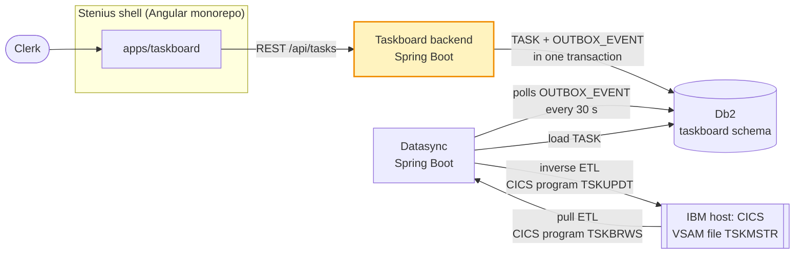
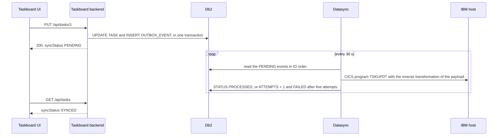

# Taskboard backend

The Taskboard backend is the REST API behind the Taskboard app, in which clerks create, edit, assign, complete and delete tasks. It owns the taskboard schema in Db2 and records every change in a transactional outbox, from which the datasync writes the change back to the IBM host, the legacy back office's system of record.



## Responsibilities

- **Task API** under `/api/tasks`: list, read, create, edit, assign, unassign and delete tasks, validated against the field limits of the host record, with errors as RFC 9457 problem details.
- **Owner of the taskboard schema**: the Flyway migrations of `TASK` and `OUTBOX_EVENT` live here. The datasync uses the schema but never migrates it.
- **Transactional outbox**: every change writes exactly one `OUTBOX_EVENT`, in the same transaction as the change of `TASK`.
- **Sync status**: every task tells whether the host has caught up with its latest change.
- **The shared local database**: `./mvnw spring-boot:run` starts an in-memory H2 database in DB2 mode and an H2 TCP server on port 9092, through which the datasync uses the same database.

The backend never talks to the host. The datasync loads the host's tasks into `TASK` and relays the outbox events to the host.

## Quickstart

You need a JDK 21. Nothing else: the Maven wrapper downloads Maven 3.10, and the database runs in memory, so there is no Docker and no database to install.

```sh
./mvnw verify            # compile, run the tests, check the formatting, build the jar
./mvnw spring-boot:run   # start the backend on http://localhost:8080
```

The backend is ready when its health endpoint says so; check from a second terminal:

```sh
curl http://localhost:8080/actuator/health
```

```json
{"groups":["liveness","readiness"],"status":"UP"}
```

Instead of `./mvnw spring-boot:run`, you can start the jar that `./mvnw verify` built:

```sh
java -jar target/taskboard-backend-0.0.1-SNAPSHOT.jar
```

Stop it with Ctrl+C. The data lives in memory, so every start begins with an empty task list.

## Configuration

Everything is in `src/main/resources/application.properties`. Each property can be overridden by its environment variable.

| Property | Environment variable | Default | Meaning |
|---|---|---|---|
| `server.port` | `SERVER_PORT` | `8080` | HTTP port of the API and of `/actuator/health` |
| `spring.datasource.url` | `SPRING_DATASOURCE_URL` | `jdbc:h2:mem:taskboard;MODE=DB2;DB_CLOSE_DELAY=-1` | The database: in-memory H2 in DB2 mode, kept until the backend stops |
| `spring.datasource.username` | `SPRING_DATASOURCE_USERNAME` | `sa` | Database user |
| `spring.datasource.password` | `SPRING_DATASOURCE_PASSWORD` | empty | Database password |
| `taskboard.h2.tcp.enabled` | `TASKBOARD_H2_TCP_ENABLED` | `true` | Start the H2 TCP server that shares the database with the datasync |
| `taskboard.h2.tcp.port` | `TASKBOARD_H2_TCP_PORT` | `9092` | Port of the H2 TCP server |

For example, to run the backend on its own without sharing its database:

```sh
TASKBOARD_H2_TCP_ENABLED=false ./mvnw spring-boot:run
```

**Database.** At start-up Flyway applies the migrations in `src/main/resources/db/migration`, then Hibernate checks that the entities fit the schema (`spring.jpa.hibernate.ddl-auto=validate`); it never changes the schema itself. `TIMESTAMP` columns hold UTC, whatever the JVM's time zone: Hibernate maps `Instant` to `TIMESTAMP` and writes it in UTC (the two `spring.jpa.properties.hibernate` settings).

**TCP server.** Once the schema is migrated, the backend starts an H2 TCP server that serves its in-memory database to other processes on the same machine. The datasync connects with `jdbc:h2:tcp://localhost:9092/mem:taskboard;MODE=DB2`, user `sa` and an empty password. The server accepts local connections only and exists for local runs; the tests never open port 9092.

**Profiles.** There are none: the default configuration is the local one. The tests add `src/test/resources/config/application.properties`, which switches the TCP server off.

**Production.** In production the backend and the datasync share one IBM Db2 database with the taskboard schema, which the backend migrates with the same Flyway scripts. This model contains no Db2 configuration, and no test runs against Db2. A Db2 deployment would add the IBM JDBC driver (`com.ibm.db2:jcc`) and Flyway's Db2 support (`org.flywaydb:flyway-database-db2`) as runtime dependencies, point `SPRING_DATASOURCE_URL` at the database (for example `jdbc:db2://db2.example.com:50000/TASKDB:currentSchema=TASKBOARD;`), set the user and password, and set `TASKBOARD_H2_TCP_ENABLED=false`.

## API reference

JSON over HTTP at `http://localhost:8080`, without authentication. The Taskboard UI calls it through its development server, which proxies `/api` to port 8080.

| Method and path | Request body | Success | Errors | Outbox event |
|---|---|---|---|---|
| `GET /api/tasks` | | 200, every task, sorted by id | | |
| `GET /api/tasks/{id}` | | 200, the task | 404 | |
| `POST /api/tasks` | `title`, optional `description`, `assignee`, `dueDate` | 201, the new task, `Location: /api/tasks/{id}` | 400 | `TASK_CREATED` |
| `PUT /api/tasks/{id}` | `title`, `description`, `status`, `assignee`, `dueDate` | 200, the changed task | 400, 404 | `TASK_UPDATED` |
| `PUT /api/tasks/{id}/assignee` | `assignee` | 200, the changed task | 400, 404 | `TASK_UPDATED` |
| `DELETE /api/tasks/{id}` | | 204 | 404 | `TASK_DELETED` |

`POST` creates an `OPEN` task with source `TASKBOARD`. `PUT /api/tasks/{id}` replaces every editable field: `null`, or a missing key, clears a field. `PUT /api/tasks/{id}/assignee` changes nothing but the assignee; `{"assignee": null}` unassigns the task. Every successful `POST`, `PUT` or `DELETE` writes exactly one outbox event; a rejected request writes none.

### The task

| Field | Type | Meaning |
|---|---|---|
| `id` | number | `TASK.ID` |
| `title` | string | 1 to 40 characters |
| `description` | string or `null` | Up to 200 characters |
| `status` | `OPEN`, `IN_PROGRESS` or `DONE` | Where the work stands |
| `assignee` | string or `null` | The user id of the clerk who works on it |
| `dueDate` | ISO date or `null` | For example `2026-10-31` |
| `source` | `TASKBOARD` or `HOST` | Created in the Taskboard or on the host |
| `hostId` | string or `null` | The task's key on the host, set by the datasync; `null` until a new task has reached the host |
| `syncStatus` | `SYNCED`, `PENDING` or `FAILED` | Whether the host has caught up, see [Sync status](#sync-status) |
| `createdAt`, `updatedAt` | ISO-8601 UTC instant | Millisecond precision, for example `2026-10-14T14:33:32.302Z` |

### Validation

The limits are those of the host record, the COBOL copybook `TSKREC`, so that every task fits the host.

| Field | Rule | Host field |
|---|---|---|
| `title` | Required, not blank, at most 40 characters | `TSK-TITLE PIC X(40)` |
| `description` | At most 200 characters | `TSK-DESC PIC X(200)` |
| `status` | `OPEN`, `IN_PROGRESS` or `DONE`; required by `PUT /api/tasks/{id}` | |
| `assignee` | `null` or a lower-case user id: a letter, then up to 7 letters or digits (`^[a-z][a-z0-9]{0,7}$`) | `TSK-USER PIC X(8)`, upper case on the host |
| `dueDate` | `null` or an ISO date | `TSK-DUE-DATE PIC 9(8)`, `00000000` for none |

Errors are `application/problem+json` (RFC 9457). A 400 for invalid fields adds `errors`, a message per field; this also covers values of the wrong type, such as `"dueDate": "31.10.2026"`. A body that is not JSON gets a 400 without `errors`, an unknown task a 404, and an unexpected error a 500 without details.

### Examples

Create a task:

```sh
curl -i -X POST http://localhost:8080/api/tasks \
  -H 'Content-Type: application/json' \
  -d '{"title": "Clarify returned direct debit", "description": "The bank returned the October instalment", "assignee": "amueller", "dueDate": "2026-10-31"}'
```

The answer is `201` with `Location: /api/tasks/1` and the new task, pending until the datasync has written it to the host:

```json
{
  "id": 1,
  "title": "Clarify returned direct debit",
  "description": "The bank returned the October instalment",
  "status": "OPEN",
  "assignee": "amueller",
  "dueDate": "2026-10-31",
  "source": "TASKBOARD",
  "hostId": null,
  "syncStatus": "PENDING",
  "createdAt": "2026-10-14T14:33:32.302Z",
  "updatedAt": "2026-10-14T14:33:32.302Z"
}
```

Create a second one with nothing but a title, then list all tasks and read one:

```sh
curl -X POST http://localhost:8080/api/tasks \
  -H 'Content-Type: application/json' \
  -d '{"title": "Call back about the claim"}'
curl http://localhost:8080/api/tasks
curl http://localhost:8080/api/tasks/1
```

The list, sorted by id (one task per line here):

```json
[
  {"id":1,"title":"Clarify returned direct debit","description":"The bank returned the October instalment","status":"OPEN","assignee":"amueller","dueDate":"2026-10-31","source":"TASKBOARD","hostId":null,"syncStatus":"PENDING","createdAt":"2026-10-14T14:33:32.302Z","updatedAt":"2026-10-14T14:33:32.302Z"},
  {"id":2,"title":"Call back about the claim","description":null,"status":"OPEN","assignee":null,"dueDate":null,"source":"TASKBOARD","hostId":null,"syncStatus":"PENDING","createdAt":"2026-10-14T14:33:32.372Z","updatedAt":"2026-10-14T14:33:32.372Z"}
]
```

Update a task, which replaces all its editable fields:

```sh
curl -X PUT http://localhost:8080/api/tasks/1 \
  -H 'Content-Type: application/json' \
  -d '{"title": "Clarify returned direct debit", "description": "The customer has changed banks", "status": "IN_PROGRESS", "assignee": "amueller", "dueDate": "2026-11-15"}'
```

```json
{
  "id": 1,
  "title": "Clarify returned direct debit",
  "description": "The customer has changed banks",
  "status": "IN_PROGRESS",
  "assignee": "amueller",
  "dueDate": "2026-11-15",
  "source": "TASKBOARD",
  "hostId": null,
  "syncStatus": "PENDING",
  "createdAt": "2026-10-14T14:33:32.302Z",
  "updatedAt": "2026-10-14T14:33:39.864Z"
}
```

Assign a task, unassign it, and delete it, which answers `204`:

```sh
curl -X PUT http://localhost:8080/api/tasks/2/assignee \
  -H 'Content-Type: application/json' \
  -d '{"assignee": "bkoch"}'
curl -X PUT http://localhost:8080/api/tasks/2/assignee \
  -H 'Content-Type: application/json' \
  -d '{"assignee": null}'
curl -i -X DELETE http://localhost:8080/api/tasks/2
```

The deleted task is gone: the answer is `404` with a problem detail (`Content-Type: application/problem+json`):

```sh
curl -i http://localhost:8080/api/tasks/2
```

```json
{"title":"Not Found","status":404,"detail":"Task 2 does not exist.","instance":"/api/tasks/2"}
```

An invalid request gets a `400` with a message per invalid field:

```sh
curl -i -X POST http://localhost:8080/api/tasks \
  -H 'Content-Type: application/json' \
  -d '{"title": "", "assignee": "A.Mueller"}'
```

```json
{
  "title": "Bad Request",
  "status": 400,
  "detail": "The request has invalid fields.",
  "instance": "/api/tasks",
  "errors": {
    "assignee": "must be a lower-case user id: a letter, then up to 7 letters or digits",
    "title": "must not be blank"
  }
}
```

## Data model

Two tables in the taskboard schema, created by `V1__create_task.sql` and `V2__create_outbox_event.sql`. Timestamps are UTC.

`TASK`, one row per task, wherever it was created:

| Column | Type | Written by | Meaning |
|---|---|---|---|
| `ID` | `BIGINT` identity, primary key | database | The task's id |
| `TITLE` | `VARCHAR(40) NOT NULL` | backend, datasync | Title |
| `DESCRIPTION` | `VARCHAR(200)` | backend, datasync | Description |
| `STATUS` | `VARCHAR(20) NOT NULL` | backend, datasync | `OPEN`, `IN_PROGRESS` or `DONE` |
| `ASSIGNEE` | `VARCHAR(8)` | backend, datasync | Lower-case user id |
| `DUE_DATE` | `DATE` | backend, datasync | Due date |
| `SOURCE` | `VARCHAR(10) NOT NULL` | backend, datasync | `TASKBOARD` (backend) or `HOST` (datasync's ETL) |
| `HOST_ID` | `VARCHAR(10)`, indexed | datasync only | The task's key on the host (`TSK-ID`): `H000001001` for a host task, `T000000042` for task 42 from the Taskboard |
| `CREATED_AT` | `TIMESTAMP NOT NULL` | backend, datasync | Creation time |
| `UPDATED_AT` | `TIMESTAMP NOT NULL` | backend, datasync | Time of the last change |

`OUTBOX_EVENT`, one row per change made through the API:

| Column | Type | Written by | Meaning |
|---|---|---|---|
| `ID` | `BIGINT` identity, primary key | database | Order of the events |
| `AGGREGATE_TYPE` | `VARCHAR(30) NOT NULL` | backend | Always `TASK` |
| `AGGREGATE_ID` | `BIGINT NOT NULL` | backend | The `TASK.ID`; no foreign key, so the events of a deleted task remain |
| `EVENT_TYPE` | `VARCHAR(30) NOT NULL` | backend | `TASK_CREATED`, `TASK_UPDATED` or `TASK_DELETED` |
| `PAYLOAD` | `VARCHAR(4000) NOT NULL` | backend | The task as JSON, see below |
| `STATUS` | `VARCHAR(20) DEFAULT 'PENDING' NOT NULL` | datasync | `PENDING`, `PROCESSED` or `FAILED` |
| `ATTEMPTS` | `INTEGER DEFAULT 0 NOT NULL` | datasync | Relay attempts so far |
| `LAST_ERROR` | `VARCHAR(1000)` | datasync | Why the last attempt failed |
| `CREATED_AT` | `TIMESTAMP NOT NULL` | backend | When the event was written |
| `PROCESSED_AT` | `TIMESTAMP` | datasync | When the host got the change |

The indexes serve the look-ups: `IX_TASK_HOST_ID` the datasync's by host key, `IX_OUTBOX_EVENT_STATUS (STATUS, ID)` its poll for pending events, and `IX_OUTBOX_EVENT_AGGREGATE (AGGREGATE_ID, ID)` the backend's search for each task's latest event.

Who writes what:

- **The backend** writes every column of `TASK` but `HOST_ID`, and inserts new outbox events. It leaves `STATUS` and `ATTEMPTS` to their defaults, `PENDING` and `0`, and never changes an event afterwards. The entities enforce this: `Task.hostId` and `OutboxEvent.status` are mapped read-only, and `ATTEMPTS`, `LAST_ERROR` and `PROCESSED_AT` are not mapped at all.
- **The datasync** writes `TASK` when it loads host tasks (with `HOST_ID`), sets `TASK.HOST_ID` once it has written a taskboard task to the host, and updates the processing columns of the outbox events. It never inserts outbox events, so its loads are never echoed back to the host.

## Transactional outbox

The backend cannot write to the host itself, and a change must reach the host even if the host is down at that moment. So each change is recorded as an event in `OUTBOX_EVENT`, in the database transaction of the change, and the datasync relays the events to the host later.

| Change | API call | Event type |
|---|---|---|
| Create | `POST /api/tasks` | `TASK_CREATED` |
| Edit, change the status | `PUT /api/tasks/{id}` | `TASK_UPDATED` |
| Assign, unassign | `PUT /api/tasks/{id}/assignee` | `TASK_UPDATED` |
| Delete | `DELETE /api/tasks/{id}` | `TASK_DELETED` |

The payload is a full snapshot of the task after the change; for `TASK_DELETED` it is the last state before the deletion. Every key is always present, `null` when empty, and consumers ignore keys they do not know. `occurredAt` is the time of the change, `hostId` the `TASK.HOST_ID` at that time:

```json
{
  "taskId": 1,
  "hostId": null,
  "title": "Clarify returned direct debit",
  "description": "The customer has changed banks",
  "status": "IN_PROGRESS",
  "assignee": "amueller",
  "dueDate": "2026-11-15",
  "source": "TASKBOARD",
  "occurredAt": "2026-10-14T14:33:39.864Z"
}
```

Guarantees:

- **Same transaction.** The change of `TASK` and its event are committed together or not at all: a change that is rolled back or fails at commit leaves no event behind. `Outbox.append` refuses to run outside a transaction.
- **One event per change.** Every successful `POST`, `PUT` or `DELETE` writes exactly one event. A rejected request (400, 404) writes none.
- **Full snapshots.** An event carries everything the host needs, so relaying it takes nothing but the event, and the latest event of a task holds its latest state.
- **In order per task.** A change locks the task's row until it commits (`SELECT ... FOR UPDATE`) and takes its time only once it holds the lock, so changes to one task run one after another, and their events' IDs and `occurredAt` follow the order of the changes. The datasync relays in ID order.
- **At-least-once delivery.** The datasync polls the pending events every 30 seconds and retries a failing one; an event can reach the host more than once, which a snapshot tolerates. After five failed attempts it marks the event `FAILED`: a host inconsistency until someone retries it.

A change on its way to the host:



To look at the outbox while the backend runs, connect to its TCP server, as the datasync does, with the H2 shell from your local Maven repository:

```sh
java -cp ~/.m2/repository/com/h2database/h2/2.4.240/h2-2.4.240.jar org.h2.tools.Shell \
  -url 'jdbc:h2:tcp://localhost:9092/mem:taskboard;MODE=DB2' -user sa -password '' \
  -sql 'SELECT ID, AGGREGATE_ID, EVENT_TYPE, STATUS, ATTEMPTS, CREATED_AT FROM OUTBOX_EVENT ORDER BY ID'
```

After the examples above:

```text
ID | AGGREGATE_ID | EVENT_TYPE   | STATUS  | ATTEMPTS | CREATED_AT
1  | 1            | TASK_CREATED | PENDING | 0        | 2026-10-14 14:33:32.347193
2  | 2            | TASK_CREATED | PENDING | 0        | 2026-10-14 14:33:32.374082
3  | 1            | TASK_UPDATED | PENDING | 0        | 2026-10-14 14:33:39.887801
4  | 2            | TASK_UPDATED | PENDING | 0        | 2026-10-14 14:33:39.911194
5  | 2            | TASK_UPDATED | PENDING | 0        | 2026-10-14 14:33:39.923417
6  | 2            | TASK_DELETED | PENDING | 0        | 2026-10-14 14:33:39.93608
(6 rows, 9 ms)
```

Without `-sql` the shell is interactive; its `list` command shows long values such as `PAYLOAD` in full.

## Sync status

`syncStatus` tells whether the host has caught up with a task. It is the status of the task's latest outbox event, the one with the highest ID:

| Latest outbox event | `syncStatus` | The Taskboard UI shows |
|---|---|---|
| `PENDING` | `PENDING` | Pending host sync |
| `PROCESSED` | `SYNCED` | In sync with host |
| `FAILED` | `FAILED` | Host inconsistency |
| None: loaded from the host and unchanged since | `SYNCED` | In sync with host |

Only the latest event counts: a task whose last change failed is `FAILED` even if earlier changes reached the host, and a new change makes it `PENDING` again. A change answers with `PENDING`, since its own event is now the latest. `GET /api/tasks` computes the sync status of all tasks in the same SQL query that reads them (a subquery on `IX_OUTBOX_EVENT_AGGREGATE`), not with a query per task.

## Run the whole Taskboard system locally

You need Java 21, Node 22 or later and the three repositories cloned side by side: [harness_demo_taskboard_backend](https://github.com/Fzum/harness_demo_taskboard_backend), [harness_demo_taskboard_datasync_cics](https://github.com/Fzum/harness_demo_taskboard_datasync_cics) and [harness_demo_taskboard_frontend_stenius](https://github.com/Fzum/harness_demo_taskboard_frontend_stenius). Start them in this order, each in its own terminal:

| # | Process | Repository | Command | Ready when |
|---|---|---|---|---|
| 1 | Backend and the shared database | harness_demo_taskboard_backend | `./mvnw spring-boot:run` | http://localhost:8080/actuator/health is UP |
| 2 | CICS host simulator | harness_demo_taskboard_datasync_cics | `./mvnw -pl cics-host-simulator spring-boot:run` | http://localhost:8090/actuator/health is UP |
| 3 | Datasync | harness_demo_taskboard_datasync_cics | `./mvnw -pl datasync spring-boot:run` | http://localhost:8081/actuator/health is UP |
| 4 | Taskboard UI | harness_demo_taskboard_frontend_stenius | `npm ci && npm start` | http://localhost:4200 loads |

Try it:

1. Open http://localhost:4200. The host's tasks appear after the datasync's first ETL run (at start-up, then every 60 s; `curl -X POST http://localhost:8081/api/sync/etl/run` runs it at once).
2. Create a task. It shows "Pending host sync" until the outbox relay has written it to the host, at most 30 s later, then "In sync with host". `curl http://localhost:8090/admin/tskmstr` shows the host's records.
3. Simulate a host outage with `curl -X POST http://localhost:8090/admin/outage -H 'Content-Type: application/json' -d '{"down":true}'` and change a task: after five failed relay attempts (about 2.5 minutes) it shows "Host inconsistency", and `curl http://localhost:8081/api/sync/inconsistencies` lists the event. End the outage with `-d '{"down":false}'` and retry it with `curl -X POST http://localhost:8081/api/sync/inconsistencies/<eventId>/retry`.

## Project structure

```text
.
├── pom.xml                                Spring Boot 4.1, Java 21, Spotless
├── mvnw, mvnw.cmd, .mvn/                  Maven wrapper (Maven 3.10)
└── src
    ├── main
    │   ├── java/com/example/taskboard
    │   │   ├── TaskboardApplication.java  entry point
    │   │   ├── ApiExceptionHandler.java   every error as a problem detail
    │   │   ├── H2TcpServer.java           shares the local database on port 9092
    │   │   ├── task/                      the task API: controller, service, entity, repository,
    │   │   │                              request and response records, sync status, event payload
    │   │   └── outbox/                    the transactional outbox: Outbox, OutboxEvent
    │   └── resources
    │       ├── application.properties     the configuration
    │       └── db/migration/              Flyway: V1__create_task.sql, V2__create_outbox_event.sql
    └── test
        ├── java/com/example/taskboard     tests, in the packages of the code they test
        └── resources                      test configuration: the TCP server off
```

## Testing

```sh
# all tests
./mvnw test
# one test class
./mvnw test -Dtest=TaskOutboxTest
# one test
./mvnw test -Dtest='TaskOutboxTest#aRolledBackChangeLeavesNeitherTheTaskNorItsEvent'
```

| Test | What it covers |
|---|---|
| `TaskApiTest` | The HTTP API: status codes, `Location`, the task's JSON, sorting, replacing and clearing fields, assigning, deleting, 404s, the validation of every field, values of the wrong type, problem details, UTC in the database |
| `TaskOutboxTest` | The outbox guarantee: one event per change with its type, `PENDING`, `0` attempts and the full snapshot; no event for a rejected request, a rollback or a failed commit; no outbox write outside a transaction; the row lock, and a change that waited for it stamped after the change it waited for; `HOST_ID` and the processing columns left to the datasync |
| `TaskSyncStatusTest` | The sync status as the datasync processes or fails events, the latest event deciding, a host task without events, and `GET /api/tasks` in a single SQL query |
| `SyncStatusTest` | The mapping from outbox status to sync status, as a plain unit test |
| `MigrationTest` | The migrations on a fresh H2 in DB2 mode: every column, type, default, key and index of the shared schema |
| `LocalRuntimeTest` | The health endpoint, and the database as the datasync sees it through the TCP server, here on a free port instead of 9092 |
| `ApiExceptionHandlerTest` | An unexpected error: a 500 problem without details, and the stack trace in the log |

The Spring tests call the API through MockMvc and share one in-memory H2 database in DB2 mode, as configured for local runs, so every test creates its own tasks and never assumes an empty database. They play the datasync's part with plain JDBC (`OutboxTable`). Surefire runs them in the time zone `Europe/Berlin`, so that a timestamp stored in local time instead of UTC fails them.

## Conventions

- Format the code with `./mvnw spotless:apply` before you commit (google-java-format, Google style). `./mvnw spotless:check` checks without changing files; `./mvnw verify` runs that check too and fails on unformatted code. There is no other linter.
- Packages by feature (`task`, `outbox`), constructor injection, records for request and response bodies, no Lombok.
- A schema change is a new Flyway migration (`V3__...sql`); never edit one that has been applied. Keep it valid for Db2 as well as for H2 in DB2 mode, update `MigrationTest`, and remember the datasync, which keeps a copy of the schema for its tests.
- The task JSON and the outbox payload are contracts with the Taskboard UI and the datasync: add fields rather than rename or remove them.
- Commit messages follow [Conventional Commits](https://www.conventionalcommits.org/): `feat: ...`, `fix: ...`, `docs: ...`, `test: ...`, `refactor: ...`, `build: ...`, `chore: ...`.

## About this repository

This repository is a small model of a real system, built to demonstrate the Dark Factory, a workflow that implements tickets across several repositories unattended. Its names and its scale are simplified: the host, its programs and records, and the people in the examples are made up, and an in-memory H2 database stands in for Db2.
